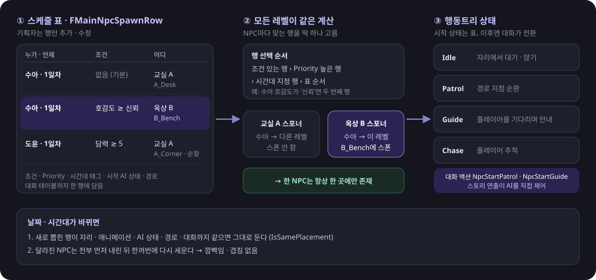

# 🌙 미열 (Febricula) — a quiet game

> **언리얼 엔진 5.8 · C++ · 비주얼 노벨 + 육성 시뮬레이션**

## ⬇ 다운로드

**[⬇ 실행 파일 다운로드 (Windows, zip 933MB)](https://drive.google.com/file/d/1aP1OcL8d3HDHQjEuPE8-4bjrkX2OfJ7O/view?usp=sharing)** — 압축을 풀고 `Febricula/Febricula.exe` 실행

---

## 📖 게임 소개

고2 때 학교를 그만둔 천율은 삼촌이 하는 고시원 방 한 칸에 얹혀살며 검정고시를 준비합니다. 시험까지 남은 시간은 나흘.
방값은 한 달 35만 원 선불이고, 지갑에는 만 이천 원이 있습니다. 하루에 한 번, **도서관에 갈지 알바를 갈지** 골라야 합니다.

| 항목 | 내용 |
|---|---|
| 장르 | 비주얼 노벨 + 육성 |
| 플랫폼 | PC (Windows) · 1인 |
| 플레이 타임 | 약 5~10분 (대사를 읽는 속도에 따라) |
| 구현 범위 | 나흘 이야기 · 엔딩 3종 · 호감도 에필로그 2종 |

- **스토리 파트** — 고시원 방 · 복도, 도서관, 시험장(학교 앞)을 오가며 대화가 진행됩니다. 선택지에 따라 대답과 호감도가 바뀝니다.
- **선택 파트** — 2·3일차 아침마다 방문을 나서며 도서관(공부)과 알바(미니게임 3종) 중 하나를 고르고, 그 조합으로 시험 결과와 엔딩이 갈립니다.
- **연출** — 매일 아침 "N일차 / 시험까지 며칠", 엔딩 끝에는 엔딩 이름을 검은 카드로 띄웁니다.
- **엔딩** — 2·3일차에 도서관에 간 횟수로 시험 결과와 엔딩이 정해지고, 호감도로 에필로그가 붙습니다. 끝나면 타이틀로 돌아가 새 게임으로 초기화됩니다.

| 엔딩 | 조건 (2·3일차 선택) | 결과 |
|---|---|---|
| A — 냉장고의 채점표 | 도서관 2번 | 평균 82점 합격 |
| B — 서랍 속 통장 | 알바 2번 | 2점 차 불합격, 8월 시험 재도전 |
| C — 둘 다 반 | 도서관 1번 + 알바 1번 | 67점 합격, 방값은 절반 |

| 에필로그 | 조건 |
|---|---|
| 도서관 그 자리에 놓고 온 커피 | 서윤 호감도 일정 이상 (1일차 선택 + 도서관 대화) |
| 방문 앞의 편의점 도시락 | 도윤 호감도 일정 이상 (1일차 복도에서 "필요해요") |

**조작** — `WASD` 이동 · 마우스 시점 · `E` 상호작용 / 대사 넘기기 · 마우스 클릭 선택지

---

## 🙋 내 담당 — 이상기 (게임플레이 프로그래밍)

| 영역 | 내용 |
|---|---|
| **대화 시스템** | 대사 출력 · 연출 서브시스템, 대화 · 조건 · 액션 데이터 모델, NPC 이벤트 선택, 대화 HUD |
| **상호작용** | 인터페이스 + 컴포넌트 기반 상호작용 구조 |
| **메인 NPC** | 스케줄 배치 스포너, 순찰 · 안내 Behavior Tree |
| **군중 시스템** | 수백 명의 행인 이동 · 회피 · LOD, MassEntity 도입, 측정 기반 최적화 (−73%, −46%) |
| **알바 미니게임** | 햄버거집 · 꽃집 · 편의점 미니게임 3종과 공통 프레임워크 |
| **본편 흐름** | 나흘 시나리오 · 엔딩 분기 데이터, 목표 표시(화살표 + 문구), 날짜 · 엔딩 카드, 타이틀 복귀 · 새 게임 초기화 |
| **시연 · 배포** | 자동 플레이(`-AutoPlay=A/B/C`)로 시연 영상 녹화, Shipping 패키징 · 검증 |

---

## 💬 대화 시스템


`UDialogueSubsystem`(Tickable World Subsystem)이 게임의 모든 대사와 연출을 맡습니다. 화면에 대사를 띄우고 사운드와 연출을 실행합니다.

- 이벤트 테이블(`FNpcEventRow`)에서 조건에 맞는 Row를 고르고, 그 Row가 가리키는 대화 노드(`FDialogueNodeRow`)를 실행
- 노드는 Branch(자동 분기)와 Choice(선택지)를 갖고, 각각 조건(`FGameCondition`)과 결과(`FGameAction`, 47종)를 가짐
- **이벤트 선택** — 조건 충족 + 최고 우선순위, 동점이면 테이블 순서
- **여러 NPC 동시 등장** — 참가자 전원 순찰 중지 → 대화 후 한꺼번에 해제
- **자리별 대화** — 같은 NPC라도 만난 장소와 진행 상황에 따라 다른 대사 (예: 서윤은 도서관 첫 방문과 두 번째 방문에서 다른 대화)

```cpp
// 조건을 만족하는 이벤트 중 Priority가 가장 높은 것
for (const auto& Pair : EventTable->GetRowMap())
{
    const FNpcEventRow* Row = (FNpcEventRow*)Pair.Value;
    if (Row->NpcId != NpcId && !Row->NpcId.IsNone()) continue;
    if (!Row->bRepeatable && Progress->IsEventCompleted(Pair.Key)) continue;
    if (!Progress->EvaluateConditions(Row->Preconditions)) continue;
    if (!BestRow || Row->Priority > BestRow->Priority)
    { BestRow = Row; BestRowName = Pair.Key; }
}
// 함께 나오는 NPC 전원을 Talk 상태로
Participants.AddUnique(NpcId);
EnterTalkForParticipants(Participants, InInstigator);
```

**대화 HUD** — `UPlayerHUDWidget`(C++)이 대화 서브시스템의 델리게이트를 받고, 화면 모양은 `WBP_PlayerHUD`가 맡습니다.
- 프롬프트 · 대화창 · 선택지 · 초상화를 한 위젯의 레이어로 쌓아, 선택지가 대화창 뒤에 깔리는 문제를 막음
- 반투명 둥근 카드 대화창, 이름표 태그(화자가 없으면 나레이션처럼 숨김), 다음 표시(▼)
- 선택지는 조건(`FGameCondition`)을 만족하지 못하면 회색 · 클릭 불가로 표시

**테스트 도구**

| 명령 · 데이터 | 용도 |
|---|---|
| `-AutoPlay=A\|B\|C` (실행 옵션) | 타이틀부터 엔딩까지 자동 진행 — 엔딩별 회귀 테스트 · 시연 녹화 · 패키징 빌드 검증 |
| `DialogueChoose N` | 떠 있는 선택지 중 N번 선택 (키 입력 없이 분기 확인) |
| `MiniGameFinish [점수]` | 진행 중인 미니게임을 바로 끝내고 보상 · 귀가 흐름 확인 |
| `dialogue.TalkNpc [NpcId]` | 키 입력 없이 지정한(없으면 가장 가까운) 메인 NPC와 대화 시작 |
| `DT_MiniGameTestEvents` · `DT_MiniGameTestDialogue` | 테스트 맵 전용 대화 → 선택지 → AP 소모까지 한 번에 확인 |
| 테스트 맵 AP 보충 | `L_MiniGameTest`에서는 시간대와 상관없이 AP 3으로 시작 (Shipping 제외) |


**목표 표시** — 플레이 테스트에서 "어디로 가서 무엇과 상호작용해야 하는지 모르겠다"는 피드백이 나와 추가했습니다.
- 대사 데이터의 `SetObjective` 액션 한 줄로 대상(NpcId 또는 액터 태그) 머리 위에 화살표를 띄우고, 화면 왼쪽 위에 목표 문구를 씀
- 목표는 `UObjectiveSubsystem`(Tickable World Subsystem)이 들고 있어 레벨이 바뀌면 자연히 사라짐 → 지우는 걸 깜빡해 다음 장면에 화살표가 남는 일이 없음
- 걸어가야 하는 장면은 기존 자동 진행(`WhenPlayerNearNpc`)과 묶어 "화살표를 따라가 다가가면 대화 시작"으로 만듦


**날짜 · 엔딩 카드** — 대사 액션 `ShowTitleCard` 한 줄로 검은 화면에 큰 제목과 부제를 띄웠다가 사라지게 합니다. 위젯 에셋 없이 C++로 위젯 트리를 만들어, 대본만 고쳐서 카드 문구를 바꿀 수 있습니다.

**대사 스크립트** — 대본은 텍스트(`Data/DT_StoryDialogue.txt`)로 쓰고, 파서가 대화 테이블 행으로 바꿉니다. 화자 · 선택지 · 분기 · 액션을 한 파일에서 읽을 수 있어 대본 수정이 에디터 작업 없이 끝납니다.

**트러블슈팅 — 달이 바뀌면 평일 · 주말이 뒤집혀 그날 이벤트가 안 뜸** (팀원이 만든 시간 시스템 `UTimeSubsystem` 수정)

| 증상 | 원인 | 수정 |
|---|---|---|
| 달이 바뀐 뒤 평일에 주말 시간표가 나오거나 그 반대 → 날짜 조건 이벤트가 엇갈림 | 주말을 `NowDay % 7`로 판정했는데 `NowDay`는 매달 1로 돌아감. 31일 다음 1일이면 요일이 그대로 이어지지 않음 | 달과 상관없이 계속 늘어나는 `AbsoluteDay`를 두고 `IsWeekend()` 한 곳에서 `(AbsoluteDay - 1) % 7`로 판정. 같은 계산이 흩어져 있던 곳을 모두 이 함수로 통일 |
| 날짜를 넘기는 순간 평일·주말 시간표가 섞일 수 있음 | 날짜를 넘기면(`SpendDay`) 평일 ↔ 주말 시간표 배열이 바뀌는데, 넘기기 전에 잡아 둔 배열 참조를 그대로 씀 | 날짜를 넘긴 뒤 시간표 배열을 다시 가져오도록 순서 변경 |
| 시간표 에셋이 비어 있으면 잘못된 메모리 접근 | 비었는지 확인하지 않고 `ScheduleDefs[0]`을 바로 읽음 · 초기화하지 않은 값이 남음 | 빈 에셋 검사와 로그 추가, 모든 값 초기화 |

검증은 날짜 테스트 테이블(`DT_Dialogue_DayTest`)로 달이 넘어가는 구간의 요일 · 시간표를 하나씩 확인했습니다.

**트러블슈팅 — 분기 조건이 하나도 맞지 않으면 그 뒤 대사가 통째로 사라짐**
- 원인: 대사 스크립트는 `@branch` 뒤의 `@jump`를 "그 외의 경우"로 쓰는데, 런타임은 분기가 하나라도 있으면 다음 노드를 보지 않고 대화를 끝냄 (알바를 안 한 밤에 침대 목표가 안 뜸)
- 해결: 맞는 분기가 없으면 `NextNodeId`로 넘어가도록 수정 → 스크립트와 런타임의 규칙을 하나로 맞춤

---

## 🖐 상호작용 시스템


**배경** — 상호작용은 플레이어 캐릭터(팀원 담당)가 완성되기 전에 만들어야 했고, 그 캐릭터 코드는 건드리지 않고 붙일 수 있어야 했습니다.

**설계** — 캐릭터 클래스에는 상호작용 로직을 한 줄도 넣지 않고 세 조각으로 나눴습니다.
- **탐색**: Pawn에 붙이는 `UInteractionComponent` → 어떤 캐릭터든 컴포넌트만 추가하면 동작
- **규칙**: `IInteractable` 인터페이스(`CanInteract` · `Prompt` · `Interact`) → 대상 쪽이 "지금 되는지 · 뭐라고 보일지 · 누르면 뭘 할지"를 정함
- **결과**: 사물(`AInteractableProp`)이 대사 · 액션 데이터를 직접 들고 있음(Prop Action) → 새 상호작용은 데이터만 채우면 되고 캐릭터 코드는 바뀌지 않음

**동작**
- 대상은 인터페이스만 구현하면 자동으로 탐색됨 → NPC, 소품, 문, 미니게임 문을 같은 방식으로 처리
- 포커스 선택 순서: 반경 내 오버랩 → 인터페이스 구현 → `CanInteract` → 정면 각도 통과 → 가장 가까운 대상
- 포커스가 바뀔 때만 HUD를 갱신하고, 대화 중에는 탐색을 멈춰 프롬프트 깜빡임을 방지
- 어떤 Pawn에든 컴포넌트만 붙이면 동작 → 이후 추가된 미니게임 문은 **추가 코드 없이** 자동 감지
- **지금 누를 수 있을 때만 문구 표시** — 사물에 `bOnlyWhenEventAvailable`을 켜면 연결된 이벤트의 시작 조건을 만족할 때만 "E - 나가기"가 뜸 (방문은 2·3일차 아침에만 열림)

**트러블슈팅 — 눌러도 아무 일 없는 "조사하기"**
- 원인: 이전 스토리의 이동 이벤트가 연결된 문 8개와 테스트 문구가 남은 의자. `CanInteract`는 "연결된 노드가 있다"만 보고 참을 돌려, 이벤트가 지워진 뒤에도 문구가 떴음
- 해결: 쓰지 않는 상호작용 설정을 비우고, 이벤트로 열리는 사물은 위의 `bOnlyWhenEventAvailable`로 조건까지 확인

---

## 🧑‍🏫 메인 NPC — 스케줄 배치 · 순찰 AI



**스케줄 배치 스포너** — 기획자가 표(`FMainNpcSpawnRow`)만 고쳐서 "몇 일차 어느 시간대엔 어디, 호감도가 높으면 다른 자리"를 정합니다.

| 누가 | 언제 | 조건 | 어디 |
|---|---|---|---|
| NpcId | 일차 + 시간대 태그 | 호감도 · 진행 (`FGameCondition`) | 레벨 + SpawnPoint ID |

- **한 NPC는 한 곳에만** — 모든 레벨의 스포너가 같은 표로 같은 계산 → 같은 행이 뽑힌 레벨만 스폰
- **여러 행이 맞을 때** — 조건 있는 행 > Priority > 시간대 지정 행 > 테이블 순서

**순찰 · 안내 Behavior Tree** — Chase / Guide(`WaitForPlayerNearby`) / Patrol(`AdvanceRouteTarget`) / Idle. 상태 전환은 이벤트 액션(`NpcStartPatrol` / `NpcStartGuide`)이 호출해 스토리 연출이 AI를 제어합니다.

**트러블슈팅 — 날이 바뀔 때 NPC가 깜빡이거나 밀려남**
- 원인: ① 행이 바뀌면 무조건 내리고 다시 세움 ② 내리기와 세우기를 NPC별로 번갈아 처리해, 앞 NPC가 자리를 비우기 전에 다음 NPC가 생김
- 해결: ① 자리 · 애니메이션 · AIState · 경로 · 대화가 같으면 그대로 둠(`IsSamePlacement`) ② 전부 내린 뒤에 세우는 두 단계로 분리

---

## 🚶 군중 시스템 — 측정 기반 최적화

[](https://www.youtube.com/watch?v=DIeaa7na75A)

[▶ 군중 영상 — 그룹 이동 · 스팟 이벤트 · 줄서기 · 병목 통과](https://www.youtube.com/watch?v=DIeaa7na75A)

수백 명의 행인을 싸게 돌리는 설계. `USubNpcDirectorSubsystem`이 행인 전원의 이동 · 회피 · LOD를 한 곳에서 처리하고(Active/Pooled 풀), `ASubNpcCharacter`는 상태만 보유합니다.

### 가벼운 이동과 직접 만든 회피

`CharacterMovement` 틱을 끄고 필요한 기능만 재구현했습니다.

| 기능 | 구현 |
|---|---|
| GroundSnap | 발밑 라인 트레이스 1회로 바닥에 붙이기 |
| WorldBlock | 지형만 캡슐 스윕 1회, 가까운 LOD만 |
| Avoidance | 0.1초마다 가까운 쌍(최대 128쌍)만 감속 · 비키기, 우측 통행 |
| BodySeparation | 매 프레임 몸 겹침 금지 |
| 플레이어 회피 | 플레이어도 장애물로 포함 (RVO 설정과 무관) |

> RVO는 구현 비용을, 직접 만든 회피는 실행 비용을 아끼는 도구입니다. 수백 명 규모라 후자를 골랐습니다. ([비교 문서](Docs/RVO_회피_비교.md))


일행 중 한 명이 줄을 서서 이벤트를 하는 동안 나머지는 옆 대기 자리에서 기다렸다가 함께 길로 복귀합니다. 행동 결정은 Mass StateTree(`ST_Passerby`)로 이전했습니다.

### 부딪힘 반응 — 속도 구간 × 좌우 방향

[](https://www.youtube.com/watch?v=dlVwlgWQhII)

[▶ 부딪힘 반응 영상 — 걷기 · 달리기 × 왼쪽 · 오른쪽](https://www.youtube.com/watch?v=dlVwlgWQhII)

플레이어가 행인에게 부딪히면 **부딪힌 속도**로 반응을, **부딪힌 방향**으로 밀려나는 쪽을 정합니다.

| 부딪힌 속도 | 반응 | 몸 |
|---|---|---|
| 0~699 (걷기) | 살짝 부딪힘 — 멈칫하고 플레이어를 돌아봄 | 제자리 (길을 막지 않게 짧게) |
| 700+ (달리기) | 놀라기 | 부딪힌 반대쪽으로 차선 이동 (오른쪽에서 치면 왼쪽으로) |

- 예전에는 기준 속도를 넘으면 피하기 · 화내기 · 놀라기를 가중치 랜덤으로 뽑아, 같은 속도로 부딪혀도 매번 달랐고 절반은 걸을 때와 거의 같은 모션이 나왔습니다. → 랜덤을 없애고 속도 구간 표(`BumpTiers`, 아키타입 데이터 테이블)로만 결정합니다.
- 좌우는 플레이어가 행인 오른쪽 벡터의 어느 쪽에 있는지(내적)로 판정합니다. 정확히 정면이면 이름 해시로 한쪽을 고정해 매번 같게 나옵니다.
- 애니메이션만 재생하고 제자리면 "맞았는데 안 밀리는" 어색함이 남아, 실제로 차선 오프셋을 옮깁니다.
- 스팟에서 앉아 있던 사람은 반응이 끝나면 하던 일로 돌아가고, 줄에 서 있던 사람은 줄에서 빠집니다.
- 내가 걸어가 닿은 경우가 아니라 **플레이어가 밀고 들어온 경우만**(접근 속도) 반응합니다.

### 성능: 측정부터 시작

`crowd.Bench <인원...>`로 인원을 단계별로 맞추고 안정화 후 CSV로 측정했습니다 (`t.MaxFPS 0`, VSync 끔, 같은 세션의 끔/켬끼리만 비교).

| 100명 기준 게임 스레드 비용 | |
|---|---:|
| 군중 로직 | **0.85 ms** |
| 애니메이션 워커 | **4.3 ms** |

> **결론** — 비싼 건 로직이 아니라 애니메이션 · 렌더링. Mass로 로직을 옮기는 것보다 "멀리 있는 사람을 다르게 그리는 것"이 효과가 크다.

### 군중 전용 애니메이션 블루프린트 — 1명당 비용 −73%

서드퍼슨 템플릿 ABP가 행인에게 필요 없는 계산을 매 프레임 하고 있어, 행인용 `ABP_Passerby`로 경량화했습니다.

| 지표 | 결과 |
|---|---|
| 1명당 한계비용 | **0.124 → 0.034 ms (−73%)** |
| 90명 기준 게임 스레드 | 22.06 → 15.38 ms (−30.3%) |
| AnimGameThreadTime | 2.98 → 1.22 ms (−59%) |

### 원경 인스턴싱과 Mass 병렬화 — 애니메이션 워커 −46%

[](https://www.youtube.com/watch?v=ZyXU0DJHRAo)

[▶ 원경 인스턴싱 영상 — 200명, 켬 · 끔 · 다시 켬](https://www.youtube.com/watch?v=ZyXU0DJHRAo)

40 m 밖 행인은 스켈레탈 메시를 숨겨 애니메이션 계산을 멈추고, 걷기 · 대기를 텍스처로 구운(AnimToTexture) 인스턴스드 메시 한 장으로 그립니다.

| 200명 CSV 중앙값 (ms) | 끔 | 켬 |
|---|---:|---:|
| 애니메이션 워커 | 6.21 | **3.35 (−46%)** |
| 게임 스레드 전체 | 8.01 | **6.91 (−14%)** |
| GPU (LOD2 재굽기 후) | 6.75 | 6.71 (추가 비용 없음) |

Mass 이동 병렬화(계산은 워커 스레드, 적용만 게임 스레드)는 0.55 → 0.38 ms (−31%). 1명당 몇 µs라 이득이 작다는 것도 수치로 확인했습니다.


### 성능 트러블슈팅

| 문제 | 원인 | 해결 |
|---|---|---|
| 원경을 켜자 GPU +1.5 ms | 원경용 샘플 메시가 LOD 1개 · 삼각형 41,052개 | 행인 메시 LOD2(12,998개)로 다시 구움 → GPU 추가 비용 소멸 |
| 원경을 켜면 60 → 22~31 FPS | 매 프레임 `MarkRenderStateDirty()`로 인스턴스 메시 전체 재생성 | `UpdateInstanceTransform(…, bMarkRenderStateDirty=false)`로 바뀐 인스턴스만 전송 |

### 군중 트러블슈팅

| 증상 | 원인 | 해결 |
|---|---|---|
| 칸 22 cm 앞에서 21초 정지 | 칸으로 가는 사람과 줄 선 사람이 서로 기다리는 교착 | 목표로 곧장 가는 방향은 도착 뒤에야 닿는 충돌 무시 → **21초 → 3.6초**, 82/82 이벤트 연결 |
| 줄이 당겨질 때 줄 전체 1~8초 정지 (양보 정지 42%) | 같은 방향으로 움직이는데 뒷사람이 연쇄 양보 | 같은 쪽으로 따라 걷는 사람 · 같은 줄끼리는 양보하지 않음 |
| 굽은 곳에서 50명 넘게 10~28초 정지 | 몸이 향한 방향으로 양보 결정 → A→B→C→A 순환 | 경로 진행 순서로 양보 (순환 없음) |
| 플레이어가 길을 막으면 28번 중 6번 실패 | "제자리 정지"가 충돌 없는 최선이라 계속 선택 | 오래 설수록 정지 비용 증가 → 옆으로 빠지는 후보 선택 |

> 군중 정체는 대부분 "서로 기다림"에서 생긴다. 양보 규칙은 순환하지 않는 기준으로 정해야 한다.

### Mass 첫 적용 실패에서 배운 것

플러그인 3개와 약 2,000줄을 한 번에 넣었다가 링크 에러로 1,139줄을 롤백했습니다. 표현 전환 · ZoneGraph 이동 · StateTree를 동시에 넣어 어디서 깨지는지 나눠 볼 수 없었고, 어디가 비싼지 모른 채 시작했기 때문입니다.
→ **측정 → 1단계 이동 병렬화 → 2단계 원경 표현 → 3단계 StateTree**로 나누고, 단계마다 켜고 끌 스위치(`crowd.Mass`, `crowd.FarInstances`)를 뒀습니다.

### 디버그 도구

| 명령 | 용도 |
|---|---|
| `crowd.DebugRole` | 머리 위에 역할과 회피 상태 표시 |
| `crowd.DebugSpot 2` | 스팟 근처 상태 · 좌표 로그 → 상태별 지속 시간 분석 |
| `crowd.LogBlock` | 정체 요약 (감속 이유별 인원, 가장 많이 막는 상대) |
| `crowd.BlockTest` | 플레이어가 길을 막는 상황 자동 측정 |
| `crowd.Bench` | 인원별 성능 측정 + 겹침 · 발 뜸 · 과속 검사 로그 |

> 상세 측정 기록: [서브NPC_성능측정_기록.md](Docs/서브NPC_성능측정_기록.md) · [CrowdPerformance.md](Docs/CrowdPerformance.md) · [CrowdFarLOD.md](Docs/CrowdFarLOD.md)

---

## 🍔 알바 미니게임

| 햄버거집 | 꽃집 | 편의점 |
|---|---|---|
| [](https://www.youtube.com/watch?v=RIz6nXd6qcw) | [](https://www.youtube.com/watch?v=r3fCzgPpiDc) | [](https://www.youtube.com/watch?v=fBJSvD1BGNg) |
| 주문대로 쌓기 · 급여 + 손재주<br>[▶ 플레이 영상](https://www.youtube.com/watch?v=RIz6nXd6qcw) | 같은 꽃 합치기 · 급여 + 체력<br>[▶ 플레이 영상](https://www.youtube.com/watch?v=r3fCzgPpiDc) | 진상 손님 사이에서 버티기 · 급여 + 말솜씨<br>[▶ 플레이 영상](https://www.youtube.com/watch?v=fBJSvD1BGNg) · [▶ 실패 영상](https://www.youtube.com/watch?v=dqAB9tOR29M) |

### 공통 프레임워크

튜토리얼 카드 → 연습 판 → 본 게임 → 결과 · 보상. 새 미니게임은 **위젯 1개 + 설정 한 줄**로 추가합니다 (꽃집 · 편의점을 이 방법으로 추가).

| 클래스 | 역할 |
|---|---|
| `UMiniGameSettings` | 키 → 위젯 클래스 · 보상 (Project Settings에서 기획자가 수정) |
| `UMiniGameSubsystem` | 띄우기, 입력 잠금, 보상 지급(중복 방지), 끝난 뒤 본편으로 복귀 |
| `UMiniGameWidget` | FinishGame / PreviewReward / ExitGame |
| `AMiniGameDoor` · `UMiniGameTravelSubsystem` | 테스트 맵에서 E키로 미니게임 레벨에 들어가고 원래 레벨로 돌아옴 |

**진입 방식 변경 — 가게 맵 대신 선택지에서 바로**
- 처음에는 가게 맵으로 이동한 뒤 가게 안의 문과 상호작용해야 시작했는데, 가게를 채울 직원 · 손님 모델이 없어 빈 가게를 걸어 다니는 시간만 늘었음
- 아침 선택지에서 가게를 고르면 `StartMiniGame` 액션이 **레벨 이동 없이 지금 레벨에서** 미니게임을 띄우도록 변경 → 가게 맵 2개와 손님 AI 코드를 걷어내고, 플레이 흐름도 짧아짐

### 화면을 그리는 방식 — 의사결정

기획 HTML 시안을 언리얼로 옮길 방식을 비교했습니다.

| 방식 | 시안을 숫자 그대로 | 수가 변하는 오브젝트 | 팀 작업 · 빌드 |
|---|---|---|---|
| WBP + BindWidget | 다시 배치해야 함 | 재료마다 위젯 생성 · 풀링 | 바이너리라 git 병합 불가 |
| Web Browser 위젯 | 이식 작업 없음 | HTML이 처리 | CEF 플러그인 용량 · 시작 시간 증가, JS↔C++ 연동 불안정 |
| **C++ NativePaint (채택)** | HTML 캔버스와 같은 좌표 · 크기 | 매 프레임 배열을 그림, 위젯 생성 없음 | 코드라 병합 가능, 플러그인 없음 |

### 꽃집 — 직접 만든 2D 물리와 시뮬레이션 밸런싱

- `FlowerPhysics.h`: 꽃 실루엣에 맞춘 원 3~5개짜리 강체. 회전 · 마찰 · 반발 충격량을 1/120초 고정 간격으로 풀어 비스듬히 걸치고 무너짐
- **트러블슈팅 — 한 자리 연타로 최대 보상**: 무작위로 놓아도 90초에 주문 26건. 물리 헤더를 그대로 쓰는 **헤드리스 시뮬레이터로 전략별 30~40판 측정** → 떨어지는 꽃 4종, 묶음 주문, 보상 기준 7 · 10 · 12 · 14건으로 조정. 결과: 천천히 9건, 쉬지 않고 11~13건

### 편의점 — 서바이벌 액션

- 손님 4종(취객 · 돌진 · 투척 · 단체) + 블랙 컨슈머 보스, 레벨업마다 서비스 스킬 12종 중 무작위 3택
- **의사결정**: 넣고 싶던 스킬을 시작 스킬로 고정하면 매 판 같은 빌드가 되어, 모든 스킬은 무작위 3택에서만 얻도록 결정

---

## 🎬 시연 자동화 · 패키징

**자동 플레이** — `-AutoPlay=A|B|C`로 실행하면 타이틀부터 엔딩까지 사람 없이 진행합니다 (`UDemoAutoPlaySubsystem`). 시연 영상 녹화와 패키징 빌드 검증에 씁니다.
- 목표 화살표 대상까지 길찾기 경로를 따라 걷고, 대사는 글자 수만큼 기다렸다 넘기고, 선택지는 경로별 순서대로 고름
- 엔딩 후 타이틀로 돌아오면 게임을 종료 → 로그가 없는 Shipping 빌드도 "정상 종료 = 끝까지 진행"으로 검증

**트러블슈팅 — 자동 플레이 캐릭터가 미끄러지듯 이동**
- 원인: `SimpleMoveToLocation`은 가속도 없이 속도만 바꿔, 가속도를 보고 걷기를 고르는 애니메이션이 대기 자세로 남음
- 해결: 길찾기로 경로만 구하고 이동은 플레이어 입력과 같은 `AddMovementInput`으로 줌

**트러블슈팅 — 패키징 빌드에서 미니게임 화면이 비어 보임**
- 원인: 미니게임 텍스처 · 효과음을 C++에서 경로로 불러와, 맵 참조만 따라가는 쿠킹에 포함되지 않음 (에디터에서는 정상)
- 해결: 해당 폴더를 `DirectoriesToAlwaysCook`에 추가하고, 패키지 파일 목록(Manifest)으로 포함 여부를 확인

---

## 🤖 AI 활용 (Claude Code + Unreal MCP)

AI 초안 → 직접 검증과 판단 → 수치로 확인. 거절한 제안까지 기록했습니다.

| 사례 | AI 초안 | 내 검증과 판단 |
|---|---|---|
| Mass 도입 방향 | 성능 측정 도구와 "로직만 옮기면 1 ms도 못 아낀다"는 결론 | 창 포커스 손실로 오염된 첫 측정 폐기 후 재측정 → 결론 확인 후 Mass 목적을 원경 표현으로 변경 |
| 행인 회피 | 1차 "앞사람이 멈추면 선다", 2차 "옆 차선으로 80 cm 비켜 간다" | 두 번 반려 (정체 · 좌우 흔들림). "앞으로 가면서 비킨다"는 기준을 정해 옆 이동을 전진 거리에 묶음 |
| 교착 재현 | 디버그 로그로 상태별 지속 시간 집계 | 한 판에서 재현이 안 돼도 넘기지 않고 같은 조건 4판 측정 후 수정 · 커밋 |
| 로그 정리 | 팀원 코드의 로그 · 바인딩 삭제 | 반려. 팀원 파일은 주석 3줄만, 내 로그는 `crowd.Log` 조건부 출력으로 정리 |

---

## 📂 주요 코드

| 파일 | 내용 |
|---|---|
| [`DialogueSubsystem.cpp`](Source/Febricula/Private/Dialogue/DialogueSubsystem.cpp) | 대사 · 연출 서브시스템, 이벤트 선택 |
| [`InteractionComponent.cpp`](Source/Febricula/Private/Interaction/InteractionComponent.cpp) | 상호작용 대상 탐색 · 포커스 |
| [`MainNpcSpawner.cpp`](Source/Febricula/Private/NPC/MainNpc/MainNpcSpawner.cpp) | 메인 NPC 스케줄 스포너 |
| [`SubNpcDirectorSubsystem.cpp`](Source/Febricula/Private/NPC/SubNpc/SubNpcDirectorSubsystem.cpp) | 군중 감독: 경로 이동, 회피, LOD |
| [`SubNpcMassProcessors.cpp`](Source/Febricula/Private/NPC/SubNpc/SubNpcMassProcessors.cpp) | Mass 이동 병렬화 · 원경 표현 프로세서 |
| [`MiniGameSubsystem.cpp`](Source/Febricula/Private/MiniGame/MiniGameSubsystem.cpp) | 미니게임 공통 프레임워크, 본편 흐름(알바 후 귀가 · 새 게임 초기화) |
| [`ObjectiveSubsystem.cpp`](Source/Febricula/Private/Objective/ObjectiveSubsystem.cpp) | 목표 표시: 대상 찾기 · 화살표 · 화면 문구 |
| [`DT_StoryDialogue.txt`](Data/DT_StoryDialogue.txt) | 본편 대본 (나흘 · 엔딩 3종) |
| [`TitleCardWidget.cpp`](Source/Febricula/Private/UI/TitleCardWidget.cpp) | 날짜 · 엔딩 카드 위젯 |
| [`DemoAutoPlaySubsystem.cpp`](Source/Febricula/Private/Demo/DemoAutoPlaySubsystem.cpp) | 시연 녹화 · 빌드 검증용 자동 플레이 |

---

## 🎨 에셋 출처

| 에셋 | 출처 | 라이선스 |
|---|---|---|
| 행인 남학생 | [Rigged Anime Japanese High School Boy](https://sketchfab.com/3d-models/845df0101cd5429e86b190be757d1365) — suzuart (Sketchfab) | [CC BY 4.0](https://creativecommons.org/licenses/by/4.0/) |
| 행인 여학생 | [Stylized Anime Japanese High School Girl 6](https://sketchfab.com/3d-models/a9a4ea84dc7844d3bf5d870a1d59b061) — suzuart (Sketchfab) | [CC BY 4.0](https://creativecommons.org/licenses/by/4.0/) |
| 주인공 · 서윤 · 도윤 등 메인 캐릭터 | [suzuart](https://sketchfab.com/suzuart) 작가의 애니메 학생 캐릭터 모델 (Sketchfab) | [CC BY 4.0](https://creativecommons.org/licenses/by/4.0/) |
| 하늘 · 시간대 | [Ultra Dynamic Sky](https://www.fab.com/listings/84fda27a-c79f-49c9-8458-82401fb37cfb) — Everett Gunther (Fab) | Fab Standard License |
| 이동 애니메이션 | [Male Locomotion Set](https://www.fab.com/listings/ad171f97-21c2-40c1-a9ad-1e474e9b2ae2) · [Female Locomotion Set](https://www.fab.com/listings/e111d3ee-26f2-496f-bd1c-72884ede5f3d) — [VanillaLoop](https://www.fab.com/sellers/VanillaLoop) (Fab) | Fab Standard License |
| 보행 애니메이션 | [Pedestrian Walks - MoCap Pack](https://www.fab.com/listings/cb5bf914-49ff-4514-aba8-e038814cac73) — MoCap Online (Fab) | Fab Standard License |
| 행인 행동 애니메이션 | [Mixamo](https://www.mixamo.com/) (Reaching Out · Sitting Talking · Texting 등) — Adobe | Mixamo 이용 약관 |
| 대화 애니메이션 | Fab 대화(Talk) 애니메이션 팩 | Fab Standard License |
| 마네킹 · 템플릿 | Unreal Engine 기본 콘텐츠 (Manny · Quinn, Third Person / Level Prototyping) — Epic Games | Unreal Engine EULA |
| 소품 재질 일부 | [ambientCG](https://ambientcg.com/) (Plastic006 · Plastic011) | [CC0](https://docs.ambientcg.com/license/) |
| 고시원 · 도서관 · 복도 · 학교 레벨 모델 | 팀 자체 제작 | — |
| 대화 초상화 · 미니게임 그림 · UI 이미지 | AI 생성 | — |

suzuart 작가의 모델은 Mixamo로 리깅한 뒤 Manny 애니메이션을 IK 리타깃해 사용했습니다.
